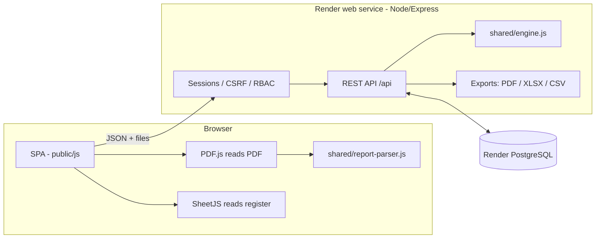
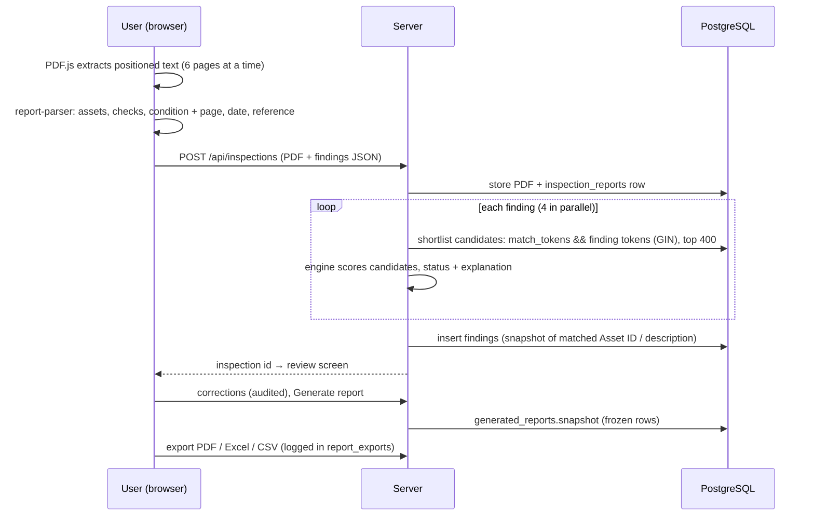
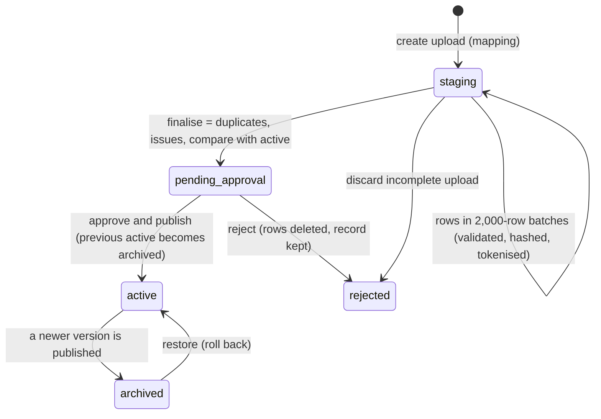

# Architecture

## Review of the previous tool and decisions

The previous tool (Rev01/Rev02) ran entirely in one browser: the master register lived in that browser's storage,
there were no users, and nothing was shared. Its strongest parts were kept and moved into the shared modules:

* the **matching engine** (synonyms, zones, carriageway, location codes, exact IDs, ambiguity, explanations), now `shared/engine.js`, tuned to the confirmed 6,804-asset Maximo register;
* the **report parser** (positioned PDF text → assets, checks, condition ratings with page numbers, assessment date), now `shared/report-parser.js`.

Key decisions:

| Decision | Reason |
|---|---|
| **PDFs are read in the browser** (PDF.js), structured results sent to the server | A 250-page PDF needs CPU for 20–60 s; doing it client-side keeps the Render instance small and responsive. The original PDF is still uploaded and stored. |
| **Matching runs on the server** against PostgreSQL | Single source of truth; the register never leaves the server; scales to 500k+ assets via a GIN index on precomputed tokens. |
| **Register versions are immutable snapshots** (`asset_versions`) + stable identities (`assets`) | Compare, roll back and keep historical inspections linked even when descriptions or IDs change. |
| **Generated reports are frozen snapshots** | Re-downloads are identical; audits can reproduce what a client received. |
| **Server-side sessions in PostgreSQL** | Instant revocation (disable user, role change, sign out other devices); stateless app instances. |
| **No front-end build step** | Fewer moving parts on Render; ES modules served directly; easy to audit. |
| **Multi-tenant from day one** (`organisation_id` everywhere) | Client portals and SaaS need no schema change. |

## System diagram

## Inspection processing flow

## Register update flow

## Matching engine

Score (0–100) = weighted description similarity (containment + Dice over canonicalised words), zone agreement,
location / carriageway agreement and keyword overlap, scaled to the four weights; minus penalties for zone or carriageway
conflicts and for decommissioned register assets. An exact Asset Number, Alternate ID or location code (e.g. `ME-FHYDR-015`)
scores its weight outright. Bands: Match ≥ 95, Likely ≥ 80 (both auto-accepted), Review ≥ 60, otherwise Not in register.
If the runner-up is within the ambiguity margin, the item is held at Review: this is what keeps the 40 identical
"Fire Hydrant (SB)" assets from being guessed.

Register rows store their features as `match_tokens` (`T:` words, `L:` location codes, `Z:` zones, `D:` direction,
`I:` identifiers, `S:` status). Very common tokens (over 20% of assets) are excluded from the database shortlist using
per-version `token_stats`, so each lookup touches a few hundred rows even in very large registers.

## Multi-tenancy and SaaS path

* Every business table has `organisation_id`; every query filters by the signed-in user's organisation.
* Email is globally unique, so one sign-in page serves all tenants.
* To add a client organisation: insert into `organisations`, then create its first Super Admin (an admin endpoint or
  seed script); its register, users, reports and audit trail are fully isolated.
* Next steps for commercial SaaS: platform-owner role across organisations, per-organisation branding (logo/colours in
  `system_settings`), billing, PostgreSQL row-level security as defence in depth, object storage (S3/R2) for files.

## Scaling notes

| Volume | Approach |
|---|---|
| Hundreds of thousands of assets | GIN token index + trigram search index; batched staging; CSV streaming exports |
| Millions of findings | Indexed by report and matched asset; reports query by `report_id` |
| Large audit logs | Indexed by organisation + time; partition `audit_logs` by month when > 50M rows |
| Many concurrent users | Stateless instances behind Render's load balancer; raise `DB_POOL_MAX` with the DB plan |
