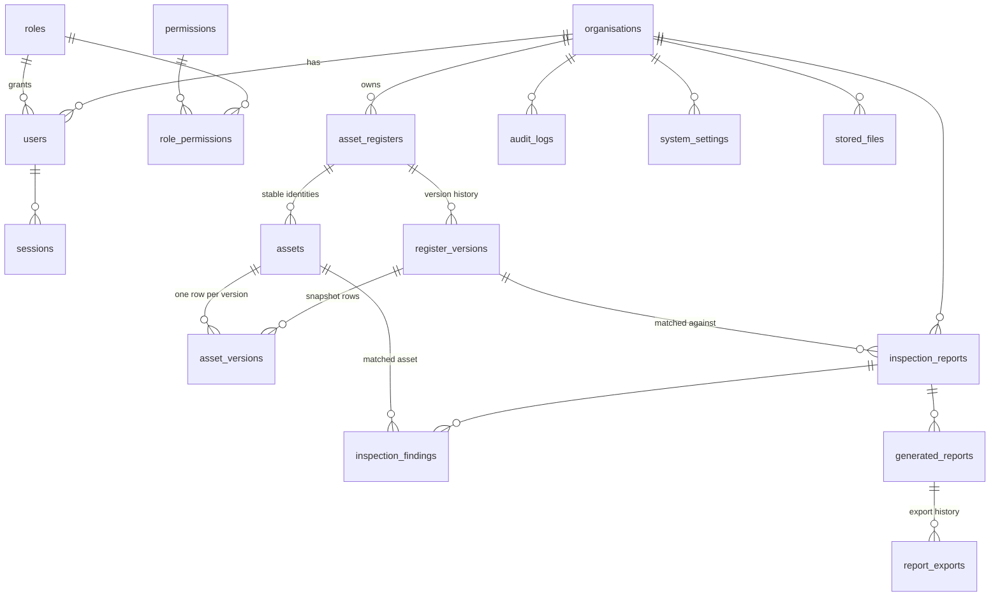

# Database schema

PostgreSQL 14+ (Render: 16). Source of truth: [`db/migrations`](../db/migrations). Migrations run automatically on start
(`scripts/migrate.js`, recorded in `schema_migrations`, serialised with an advisory lock).

## Entity relationships

## Tables

| Table | Purpose | Key columns / notes |
|---|---|---|
| `organisations` | Tenants | `slug` unique, `status` |
| `roles`, `permissions`, `role_permissions` | RBAC matrix | 4 roles with `level`; 21 permissions |
| `users` | Accounts | unique `lower(email)` (live rows), scrypt `password_hash`, lockout fields, soft delete `deleted_at` |
| `sessions` | Server-side sessions | `id` = SHA-256 of cookie token, `csrf_token`, idle + absolute expiry |
| `password_reset_tokens` | One-time reset links | hashed token, expiry, `used_at` |
| `system_settings` | Per-organisation settings (jsonb) | groups: `matching`, `reports`, `registers`, `inspections` |
| `stored_files` | Original registers and PDFs | `bytea`, SHA-256 (move to object storage at scale) |
| `asset_registers` | A register (one per org today; many supported) | `active_version_id` |
| `register_versions` | Version history | `status` staging/pending_approval/active/archived/rejected, `mapping`, `headers`, `change_summary`, `token_stats`, uploader/approver |
| `assets` | Stable identity per Asset ID | unique `(register_id, upper(asset_code))`, `state`, `notes`, `date_added` |
| `asset_versions` | Asset snapshot per version | mapped fields, `attributes` (all original columns), `content_hash`, `match_tokens` (GIN), `issues`, `is_primary`, `change_type` |
| `asset_categories` | Category list | from the mapped category column |
| `inspection_reports` | Uploaded reports | report ref, assessment date + source, counts, register version used |
| `inspection_findings` | One row per asset in a report | condition + pages, checks, defects, notes, match status, confidence, explanation, candidates, matched asset + **snapshots** |
| `generated_reports` | Generated registers | frozen `snapshot` jsonb, draft/approved, view count |
| `report_exports` | Export history | format, file name, who, when |
| `audit_logs` | Compliance trail | action, entity, summary, `details` jsonb (before/after), IP, user agent |

## Indexes that matter at scale

* `asset_versions_tokens_idx` (GIN on `match_tokens`): candidate shortlist for matching.
* `asset_versions_search_idx` (trigram GIN on code + description + location): asset search and manual assignment.
* `asset_versions_version_code_idx` on `(version_id, upper(asset_code))`: version comparison and publishing.
* `inspection_findings_report_idx`, `inspection_findings_asset_idx`: report pages and asset inspection history.
* `audit_logs_org_time_idx`: audit log browsing.

## Historical integrity

* Archived register versions are never modified, so a version can always be compared, exported or restored.
* Findings store `asset_code_snapshot`, `asset_description_snapshot` and `asset_location_snapshot` at match time, plus a
  link to the stable `assets.id`, so inspections stay correct and linked after later register changes.
* Generated reports store their rows, so a re-download reproduces exactly what was delivered.
